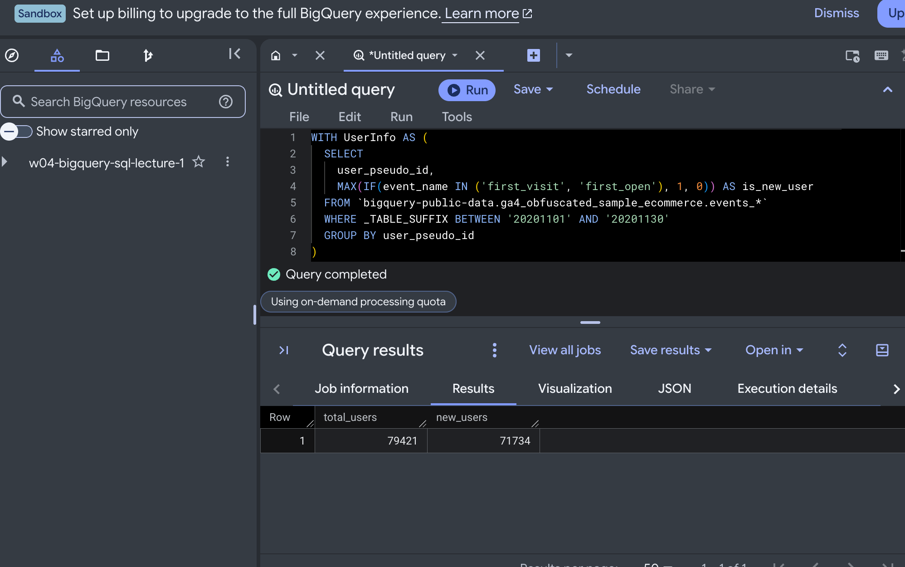
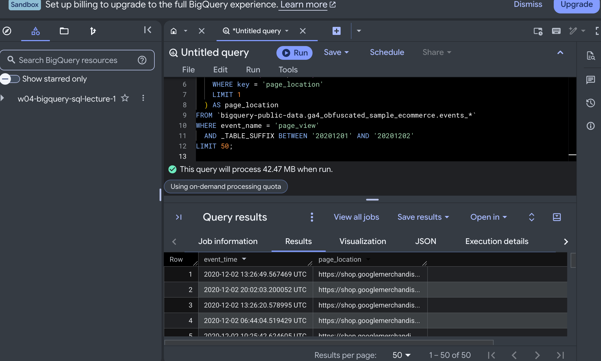
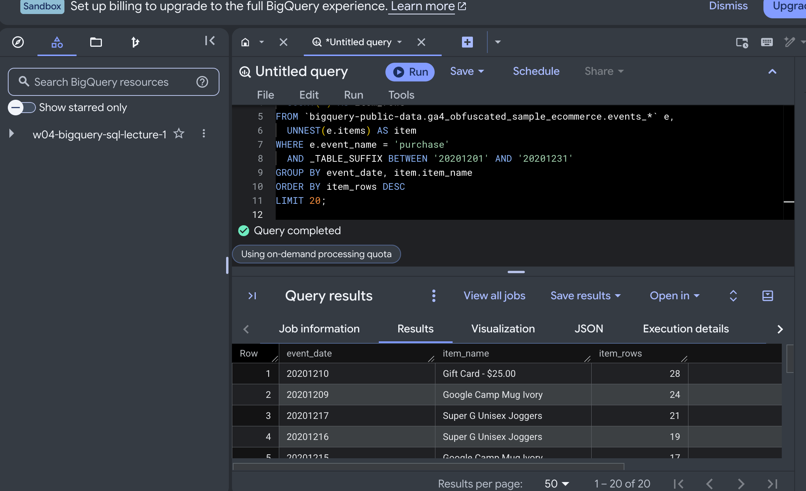
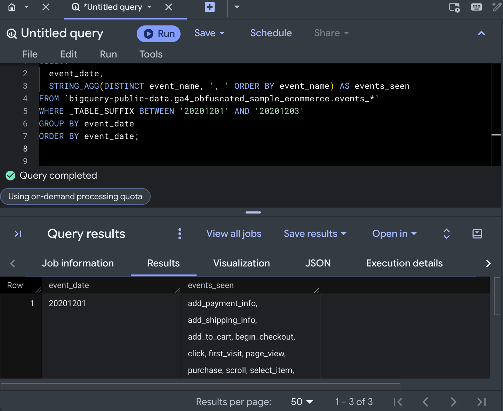
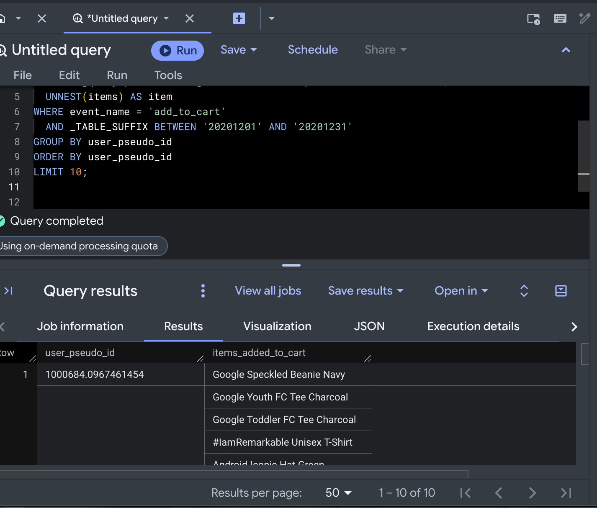
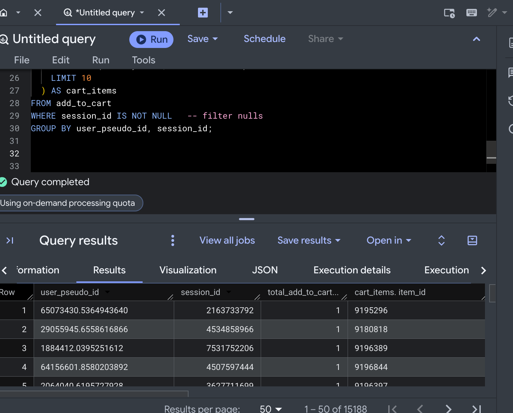
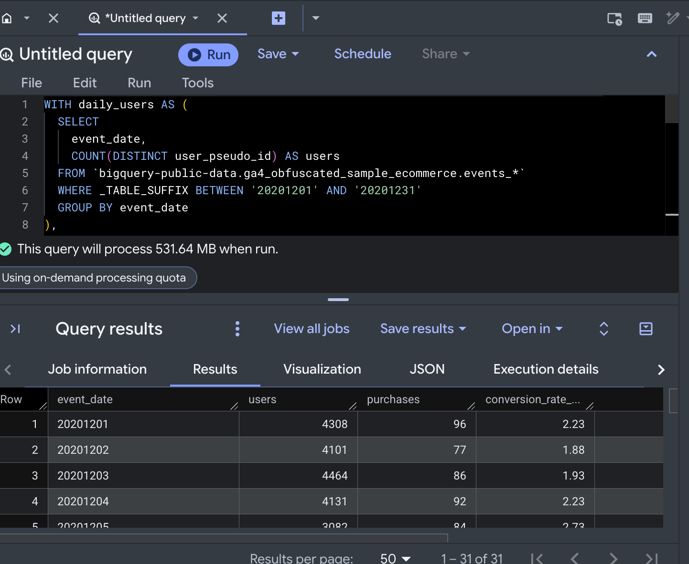
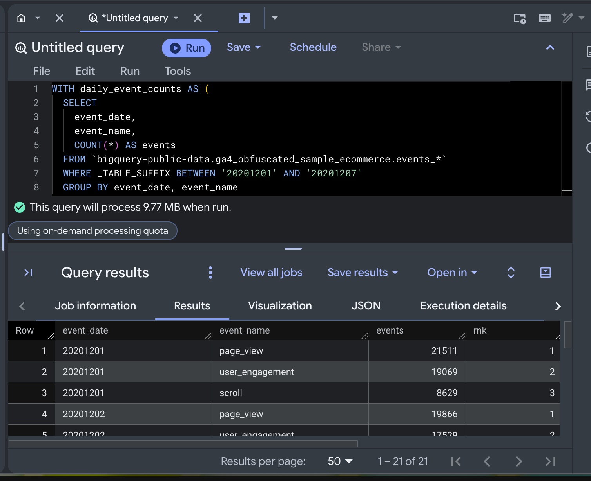
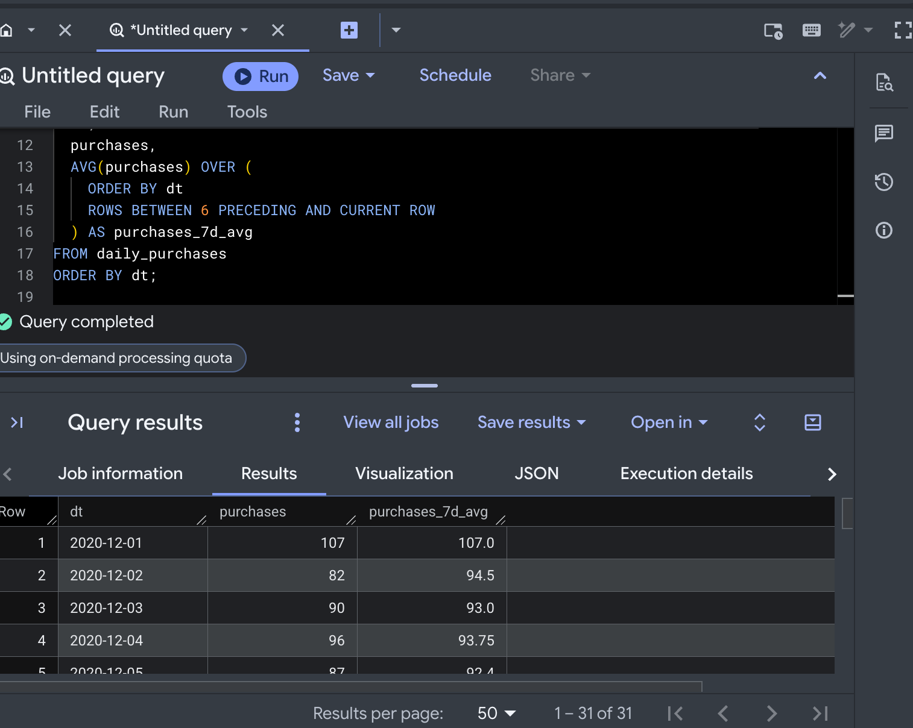
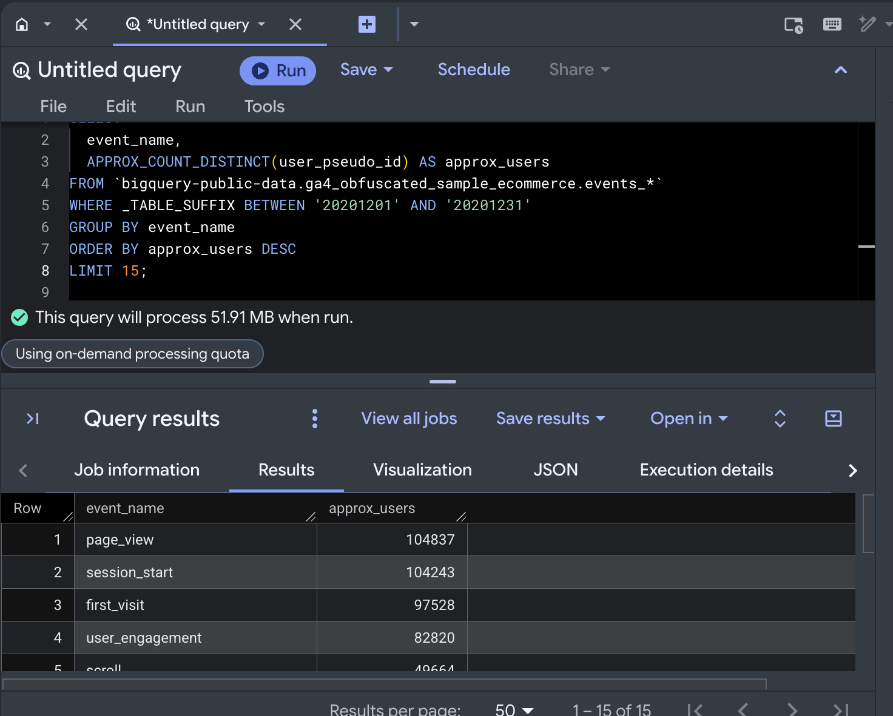

# Introduction

In this notebook, I walk through every query from Lecture 2 and document what each one does and what the output tells me. All of the queries run against the public GA4 sample e-commerce dataset (`bigquery-public-data.ga4_obfuscated_sample_ecommerce.events_*`), which covers November 1, 2020 through January 31, 2021. Each section includes the query, a plain-language explanation, a screenshot of the BigQuery output, and my interpretation of the results.

Two ideas show up in almost every query:

- **Events are the unit of data.** Every row in `events_*` is one user action, such as a page view or a purchase.
- **Arrays hold nested data.** Fields like `event_params` and `items` are arrays, so I need `UNNEST` to read what is inside them.

# CTEs (WITH) to Structure Logic

A common table expression (CTE) creates a named "mini table" inside a query. It lets me build the logic in readable steps instead of one long, nested statement.

## Total Users and New Users

``` sql
-- Query 1: Total users + new users (November 2020)
WITH UserInfo AS (
  SELECT
    user_pseudo_id,
    MAX(IF(event_name IN ('first_visit', 'first_open'), 1, 0)) AS is_new_user
  FROM `bigquery-public-data.ga4_obfuscated_sample_ecommerce.events_*`
  WHERE _TABLE_SUFFIX BETWEEN '20201101' AND '20201130'
  GROUP BY user_pseudo_id
)
SELECT
  COUNT(*) AS total_users,
  SUM(is_new_user) AS new_users
FROM UserInfo;
```

**What it does:** The CTE named `UserInfo` produces one row per user. `MAX(IF(...))` flags a user as new (1) if they triggered at least one `first_visit` or `first_open` event in November 2020, and as returning (0) otherwise. The final `SELECT` counts every user and adds up the flags to get the number of new users.



**What the output means:** The store had 79,421 total users in November 2020, and 71,734 of them were new. That means roughly 90% of the audience was visiting for the first time, which tells me the store was acquiring a lot of fresh traffic but had a relatively small base of returning customers.

# Arrays and UNNEST

GA4 stores many fields inside arrays. The two I use most here are `event_params` (key/value pairs that describe an event) and `items` (the products in an e-commerce event).

## Pattern A: Scalar Subquery Extraction

``` sql
-- Query 2A: Pattern A - scalar subquery extraction (does not add rows)
SELECT
  TIMESTAMP_MICROS(event_timestamp) AS event_time,
  (
    SELECT value.string_value
    FROM UNNEST(event_params)
    WHERE key = 'page_location'
    LIMIT 1
  ) AS page_location
FROM `bigquery-public-data.ga4_obfuscated_sample_ecommerce.events_*`
WHERE event_name = 'page_view'
  AND _TABLE_SUFFIX BETWEEN '20201201' AND '20201202'
LIMIT 50;
```

**What it does:** For each `page_view` event, a small subquery looks inside `event_params`, finds the entry whose key is `page_location`, and returns its string value. Because it is a scalar subquery, it does not create extra rows, so one event stays one row. `TIMESTAMP_MICROS` converts the raw microsecond timestamp into a readable date and time.



**What the output means:** The result returned 50 rows (because of `LIMIT 50`), each with a timestamp from December 2, 2020 and the URL of the page that was viewed. The URLs all point to the Google Merchandise Store, which confirms the parameter extraction worked. This is the safest way to pull one parameter out of GA4 because the row count stays the same.

## Pattern B: Flattening with UNNEST in FROM

``` sql
-- Query 2B: Pattern B - flattening with UNNEST in FROM (adds rows: grain changes)
SELECT
  event_date,
  item.item_name,
  COUNT(*) AS item_rows
FROM `bigquery-public-data.ga4_obfuscated_sample_ecommerce.events_*` e,
  UNNEST(e.items) AS item
WHERE e.event_name = 'purchase'
  AND _TABLE_SUFFIX BETWEEN '20201201' AND '20201231'
GROUP BY event_date, item.item_name
ORDER BY item_rows DESC
LIMIT 20;
```

**What it does:** `UNNEST(e.items)` turns each product inside a purchase event into its own row. After unnesting, the data is no longer at the event level; it is at the item-per-event level, which means the grain of the table changed. The query then counts how many times each item appears in purchases on each day and returns the top 20 combinations.



**What the output means:** The top result was the \$25.00 Gift Card on December 10, 2020 with 28 purchase rows, followed by the Google Camp Mug Ivory on December 9 (24) and the Super G Unisex Joggers on December 17 (21) and December 16 (19). These dates fall in the early to mid-December holiday shopping window, and gift cards, mugs, and apparel make sense as popular gift items.

# STRING_AGG and ARRAY_AGG

These aggregation functions combine many values into a single row per group. `STRING_AGG` builds one text string, and `ARRAY_AGG` builds an array.

## Event Names Seen per Day

``` sql
-- Query 3A: Event names seen per day (STRING_AGG)
SELECT
  event_date,
  STRING_AGG(DISTINCT event_name, ', ' ORDER BY event_name) AS events_seen
FROM `bigquery-public-data.ga4_obfuscated_sample_ecommerce.events_*`
WHERE _TABLE_SUFFIX BETWEEN '20201201' AND '20201203'
GROUP BY event_date
ORDER BY event_date;
```

**What it does:** For each day, `STRING_AGG` collapses all of the distinct event names into one comma-separated text string, sorted alphabetically. `DISTINCT` makes sure each event name only appears once per day.



**What the output means:** The query returned 3 rows, one for each day from December 1 to December 3, 2020. On December 1, the list includes `add_payment_info`, `add_shipping_info`, `add_to_cart`, `begin_checkout`, `click`, `first_visit`, `page_view`, `purchase`, `scroll`, and `select_item`, among others. Reading the list from top to bottom shows the whole shopping journey, from browsing to checkout, in a single cell.

## Use Case 1: Items Added to Cart per User

``` sql
-- Query 3B: Use Case 1 - list of items added to cart per user (ARRAY_AGG)
SELECT
  user_pseudo_id,
  ARRAY_AGG(item.item_name) AS items_added_to_cart
FROM `bigquery-public-data.ga4_obfuscated_sample_ecommerce.events_*`,
  UNNEST(items) AS item
WHERE event_name = 'add_to_cart'
  AND _TABLE_SUFFIX BETWEEN '20201201' AND '20201231'
GROUP BY user_pseudo_id
ORDER BY user_pseudo_id
LIMIT 10;
```

**What it does:** The query unnests the items in each `add_to_cart` event, then uses `ARRAY_AGG` to gather every item name a user added during December into a single array. The result has one row per user, and `LIMIT 10` keeps the output small.



**What the output means:** The result returned 10 users. The first user (ID 1000684.0967461454) added several different products, including a Google Speckled Beanie Navy, a Google Youth FC Tee Charcoal, a Google Toddler FC Tee Charcoal, a #IamRemarkable Unisex T-Shirt, and an Android Iconic Hat Green. Seeing all of one user's items in a single row makes it easy to understand what a shopper was interested in.

## Use Case 2: Session-Level Cart Summary

``` sql
-- Query 3C: Use Case 2 - session-level cart summary (ARRAY_AGG of STRUCTs)
WITH add_to_cart AS (
  SELECT
    user_pseudo_id,
    (
      SELECT value.int_value
      FROM UNNEST(event_params)
      WHERE key = 'ga_session_id'
    ) AS session_id,
    TIMESTAMP_MICROS(event_timestamp) AS event_timestamp,
    i.item_id,
    i.item_name,
    i.quantity,
    i.price
  FROM `bigquery-public-data.ga4_obfuscated_sample_ecommerce.events_*`,
    UNNEST(items) AS i
  WHERE event_name = 'add_to_cart'
    AND _TABLE_SUFFIX BETWEEN '20201101' AND '20210131'  -- cost control
)
SELECT
  user_pseudo_id,
  session_id,
  COUNT(*) AS total_add_to_cart_events,
  ARRAY_AGG(
    STRUCT(item_id, item_name, quantity, price, event_timestamp)
    ORDER BY quantity DESC, event_timestamp ASC
    LIMIT 10
  ) AS cart_items
FROM add_to_cart
WHERE session_id IS NOT NULL   -- filter nulls
GROUP BY user_pseudo_id, session_id;
```

**What it does:** The CTE pulls the session ID out of `event_params` and flattens each cart item into its own row. The main query then groups by user and session, counts the add-to-cart events, and uses `ARRAY_AGG(STRUCT(...))` to build a nested cart summary of up to 10 items per session, ordered by quantity (highest first) and then by time (earliest first). Rows with no session ID are filtered out. I widened the date range to cover the full sample dataset (November 1, 2020 to January 31, 2021) so the results include all available sessions.



**What the output means:** The query returned 15,188 rows, which means 15,188 unique user-and-session combinations added at least one item to a cart during the sample period. In the rows visible in my screenshot, the `total_add_to_cart_events` value is 1, so those sessions added a single item, and the nested `cart_items` column lists the item ID and the other details. This structure is useful for cart analysis because everything about a session's cart sits in one row.

# Joins

A join combines tables using a matching key. Here I use a `LEFT JOIN` so that every day stays in the results, even if a day had no purchases.

## Daily Users, Purchases, and Conversion Rate

``` sql
-- Query 4: Daily users joined with daily purchases + conversion rate
WITH daily_users AS (
  SELECT
    event_date,
    COUNT(DISTINCT user_pseudo_id) AS users
  FROM `bigquery-public-data.ga4_obfuscated_sample_ecommerce.events_*`
  WHERE _TABLE_SUFFIX BETWEEN '20201201' AND '20201231'
  GROUP BY event_date
),
daily_purchases AS (
  SELECT
    event_date,
    COUNT(DISTINCT
      (SELECT value.string_value
       FROM UNNEST(event_params)
       WHERE key = 'transaction_id')
    ) AS purchases    -- distinct transactions
  FROM `bigquery-public-data.ga4_obfuscated_sample_ecommerce.events_*`
  WHERE event_name = 'purchase'
    AND _TABLE_SUFFIX BETWEEN '20201201' AND '20201231'
  GROUP BY event_date
)
SELECT
  u.event_date,
  u.users,
  -- turns "no purchase row (NULL)" into 0 purchases
  IFNULL(p.purchases, 0) AS purchases,
  -- conversion rate: % of daily users who made a purchase
  ROUND(
    IFNULL(p.purchases, 0) / NULLIF(u.users, 0) * 100, 2
  ) AS conversion_rate_pct   -- NULLIF prevents division by zero
FROM daily_users u
LEFT JOIN daily_purchases p
  ON u.event_date = p.event_date
ORDER BY u.event_date;
```

**What it does:** I build two CTEs. The first counts distinct users per day, and the second counts distinct purchase transactions per day by pulling `transaction_id` out of `event_params`. The `LEFT JOIN` keeps every day from `daily_users`. `IFNULL` converts a missing purchase count to 0, and `NULLIF` prevents a division-by-zero error when I calculate the conversion rate (purchases divided by users, times 100).



**What the output means:** The query returned 31 rows, one for each day in December 2020. In the first five days shown, daily users ranged from 3,082 to 4,464, purchases ranged from 77 to 96, and the conversion rate ranged from 1.88% to 2.73%. December 5 had the highest conversion rate in that stretch (2.73%) even though it had the fewest users (3,082), which suggests that a smaller but more purchase-ready audience can convert better than a larger one. December 2 had the lowest rate (1.88%).

# Window Functions and QUALIFY

Window functions calculate across a set of related rows without collapsing them into one row per group. `QUALIFY` then lets me filter on the result of a window function.

## Top 3 Event Types per Day

``` sql
-- Query 5A: Top 3 event types per day (RANK + QUALIFY)
WITH daily_event_counts AS (
  SELECT
    event_date,
    event_name,
    COUNT(*) AS events
  FROM `bigquery-public-data.ga4_obfuscated_sample_ecommerce.events_*`
  WHERE _TABLE_SUFFIX BETWEEN '20201201' AND '20201207'
  GROUP BY event_date, event_name
)
SELECT
  event_date,
  event_name,
  events,
  RANK() OVER (PARTITION BY event_date ORDER BY events DESC) AS rnk
FROM daily_event_counts
WHERE TRUE
QUALIFY rnk <= 3
ORDER BY event_date, rnk;
```

**What it does:** The CTE counts events by day and event name. `RANK()` then ranks the event types within each day (`PARTITION BY event_date`) from most to least frequent, and `QUALIFY rnk <= 3` keeps only the top 3 for each day. I included `WHERE TRUE` because BigQuery requires `QUALIFY` to be used alongside a `WHERE`, `GROUP BY`, or `HAVING` clause.



**What the output means:** The query returned 21 rows, which is 3 event types for each of the 7 days from December 1 to December 7. On December 1, the top three were `page_view` (21,511), `user_engagement` (19,069), and `scroll` (8,629). On December 2, `page_view` (19,866) and `user_engagement` (17,529) held the top two spots again. This tells me that browsing and engagement activity dominates the event volume, while purchase-related events are much less frequent.

## Rolling 7-Day Average of Purchases

``` sql
-- Query 5B: Rolling 7-day average of daily purchases
WITH daily_purchases AS (
  SELECT
    PARSE_DATE('%Y%m%d', event_date) AS dt,
    COUNT(*) AS purchases
  FROM `bigquery-public-data.ga4_obfuscated_sample_ecommerce.events_*`
  WHERE event_name = 'purchase'
    AND _TABLE_SUFFIX BETWEEN '20201201' AND '20201231'
  GROUP BY dt
)
SELECT
  dt,
  purchases,
  AVG(purchases) OVER (
    ORDER BY dt
    ROWS BETWEEN 6 PRECEDING AND CURRENT ROW
  ) AS purchases_7d_avg
FROM daily_purchases
ORDER BY dt;
```

**What it does:** The CTE converts the text date into a real `DATE` and counts purchase events per day. The window function then averages the current day and the six days before it, which produces a smoothed 7-day trend that reduces day-to-day noise.



**What the output means:** The query returned 31 daily rows. Daily purchases in the first few days were 107, 82, 90, 96, and 87, while the 7-day average settled around 92 to 94. For the first six days of the month, the average is calculated over fewer than seven days because there are not enough earlier rows yet, so it becomes more stable after that. One more thing I noticed is that these purchase counts are slightly higher than the purchase counts in Query 4 (for example, 107 versus 96 on December 1). That is because this query uses `COUNT(*)` on purchase events, while Query 4 counts distinct `transaction_id` values, so the difference likely comes from purchase events that repeat for the same transaction.

# Approximate Functions

Approximate functions return "close enough" answers faster and at a lower cost on very large datasets.

## Approximate Distinct Users per Event Type

``` sql
-- Query 6: Approximate distinct users per event type
SELECT
  event_name,
  APPROX_COUNT_DISTINCT(user_pseudo_id) AS approx_users
FROM `bigquery-public-data.ga4_obfuscated_sample_ecommerce.events_*`
WHERE _TABLE_SUFFIX BETWEEN '20201201' AND '20201231'
GROUP BY event_name
ORDER BY approx_users DESC
LIMIT 15;
```

**What it does:** `APPROX_COUNT_DISTINCT` estimates how many unique users triggered each event type. It runs faster and costs less than `COUNT(DISTINCT ...)`, with a small margin of error, which is a good trade-off on large datasets. The query returns the 15 event types reached by the most users in December 2020.



**What the output means:** The query returned 15 event types. `page_view` reached about 104,837 users, followed by `session_start` (104,243), `first_visit` (97,528), `user_engagement` (82,820), and `scroll` (about 49,664). The numbers drop quickly as events move deeper into the shopping journey, which shows the typical funnel shape: most people view pages, fewer engage, and far fewer scroll or take later actions such as checkout.

# Conclusion

Working through Lecture 2 showed me how much structure GA4 data really has. CTEs made my queries easier to read and debug, and `UNNEST` gave me access to the nested parameters and items that hold most of the useful detail. I also learned that unnesting changes the grain of the data, so I need to know whether I am counting events or item rows. `STRING_AGG` and `ARRAY_AGG` helped me summarize behavior in a single row, the `LEFT JOIN` let me connect users and purchases to calculate conversion rate, and the window functions gave me rankings and trends without losing detail. Finally, approximate functions showed me how to keep analysis fast and cost-aware. These skills are directly useful for building marketing reports and dashboards that answer questions about traffic, engagement, and conversion.

# Appendix

# Appendix

- **Website:** [https://rubencgarcia.github.io/IC-CP-W05-BigQuery-SQL-Lecture-2/](https://rubencgarcia.github.io/IC-CP-W05-BigQuery-SQL-Lecture-2/)
- **GitHub Repository:** [https://github.com/rubencgarcia/IC-CP-W05-BigQuery-SQL-Lecture-2](https://github.com/rubencgarcia/IC-CP-W05-BigQuery-SQL-Lecture-2) [Garcia-Ruben-lecture2-ga4.sql](Garcia-Ruben-lecture2-ga4.sql)
